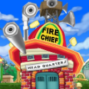

<p align="center">
  
</p>

<h1 align="center">ToonHQ+</h1>

<p align="center">
  ToonHQ+ (ToonHQ Plus) is an unofficial independently created browser extension that enhances the <a href="https://toonhq.org/groups">ToonHQ</a> experience.
</p>

<p align="center">
  <a href="https://chromewebstore.google.com/detail/toonhq+/npoiljoenaihnleoogcmcpfgdikdjmfg"></a>
  <a href="https://addons.mozilla.org/en-US/firefox/addon/toonhq/"></a>
</p>

## Features

### Groups
- **CEO/CJ Tier Info**: No more guessing! See real-time Pink Slip counts and Lawyer counts based on your group.
- **Toon Notes**: Keep track of which toons are Toony and which are Stinky with private notes. These toons are highlighted when they join your groups.
- **Group History**: Check your past groups in the sidebar and add notes for past teammates, even after the group has disbanded.
- **District Indicators**: See district population and chat limitations at a glance on group cards, invasion cards and district menus.
- **Quick Create**: Create boss and facility groups right from the Groups tab. Teleport takes you in unlisted, or List on HQ posts the group for others to join.
- **Toon Details**: Hover over toons for laff, gags and suit levels. Right click a toon's picture to open it in the Toontown Help styling app.

### Shticker Book
Your trusty Shticker Book on the bottom left of the screen.

- **Boss, Facility and Field Office Info**: Details on every boss, facility and field office, such as merits awarded and boss healths and attacks.
- **Facilities Calculator**: Calculate any cog battle over multiple rounds, with presets for every facility supervisor battle and all their status effects.
- **Boiler Calculator**: Track the Boiler's health over the course of a run. Be certain that your gags will eliminate the Boiler and that you don't go sad!
- **Gag Calculator**: Plan your gags against any cog, with accuracy, Defense, Remote Controls, Oil Cans and Toons Hit SOS cards all accounted for.
- **Reference Sheets**: Common Gag Combos, Accuracy, Cog Healths and Oil Can Damage right next to the Gag Calculator.

### Events
- **Cavalcade Tracker**: Live timers during Cartoonival showing where the Cavalcade is, how long it's been running, and when the next location is announced.

### Toon Tracker
Sync with your game as a Companion App and track your toons' rewards, suit progression and ToonTasks in real time!

- **Reward Notifications**: Opt in to desktop notifications whenever your toons earn new rewards.
- **Rewards History and Stats**: See your toons' recent rewards and what they've earned over the past day, week and month, with a Rewards Timeline.

### Customization
- **Dark Mode**: A dark theme for ToonHQ that can follow your system setting, until an official dark theme is available on ToonHQ.
- **Customizable Navigation**: Pin your favorite pages like Invasions or Field Offices, and hide the rest for a clean view.
- **Sync and Backup**: Sync your lists and notes between browser profiles, and import or export your saved data at any time.

## Privacy

All your data (notes, history, toon lists, and tracker records) is stored locally in your browser.
We don't track your gameplay or share your private notes with anyone.

- The Toon Tracker talks to your game client directly on your computer. No data ever leaves your computer.
- If you turn on sync, your lists and notes go through your browser's own sync (your Google or Firefox account), not through any ToonHQ+ server.
- The extension only fetches public information like district populations and the Cavalcade location. It never sends your notes, toons or tracker data anywhere.

## AI Disclaimer

Claude (Anthropic), Codex (OpenAI) and Gemini (Google) models were used to help write the code for this extension. They were only used during development and are not part of the extension. 

Your data still never leaves your device. Neither I nor any AI model has access to it.

## Development

Built with [WXT](https://wxt.dev), React and Tailwind CSS. You need [Node.js](https://nodejs.org) 22.6 or newer.

```bash
npm install          # install dependencies
npm run dev          # run in Chrome with live reload
npm run dev:firefox  # run in Firefox with live reload
```

| Command | What it does |
| --- | --- |
| `npm run build` / `npm run build:firefox` | Production build in `.output/` |
| `npm run zip` / `npm run zip:firefox` | Build a store-ready zip |
| `npm test` | Run the unit tests |
| `npm run compile` | Type-check with TypeScript |

### Project layout

| Path | Contents |
| --- | --- |
| `entrypoints/sidebar.content/` | The main panel injected into ToonHQ: tabs, calculators and game data |
| `entrypoints/popup/` | The toolbar popup |
| `entrypoints/background.ts` | Background service worker (notifications, alarms, tracker) |
| `entrypoints/*.content.ts` | Smaller content scripts (display mode, navbar, banners) |
| `public/` | Images, fonts and page scripts bundled with the extension |
| `tests/` | Unit tests (`node --test`) |
| `tools/` | Scripts for assets and development |

## Feedback

Have any questions, suggestions, complaints, or other feedback? Feel free to reach out!

- [Open an issue](https://github.com/zahidul23/toonhqplus/issues) on GitHub
- Discord: [@hoque](https://discord.com/users/140381706992484352)
- Email: [feedback@toontown.help](mailto:feedback@toontown.help)

## Disclaimer

ToonHQ+ is independently developed and is not affiliated with, maintained, or endorsed by the ToonHQ team.
